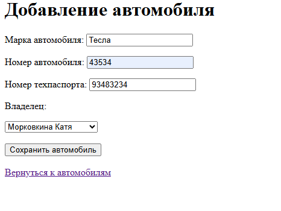
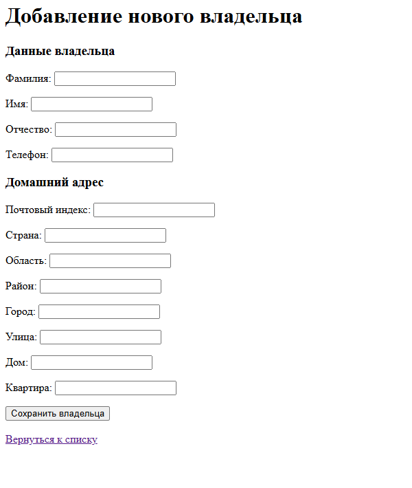
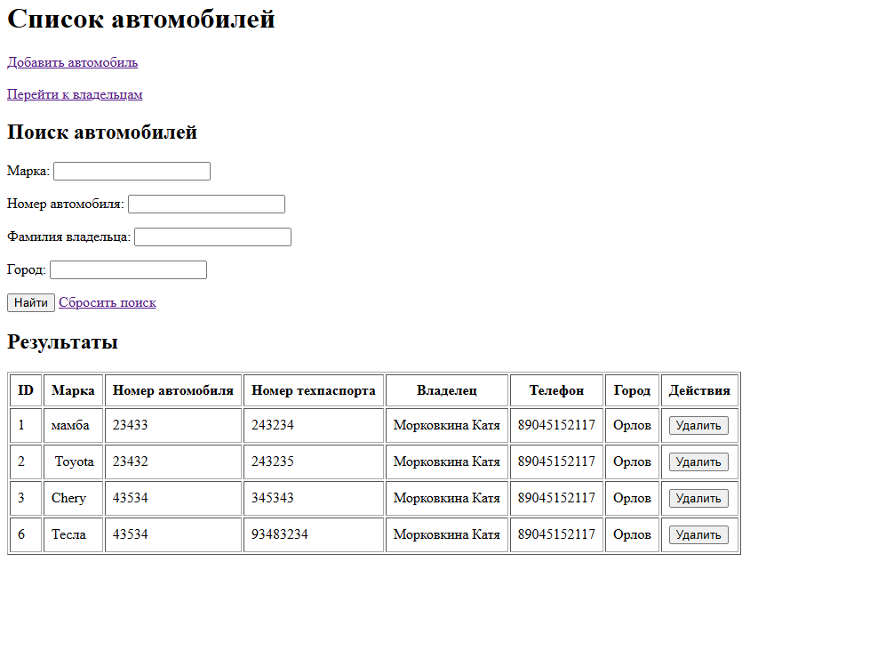
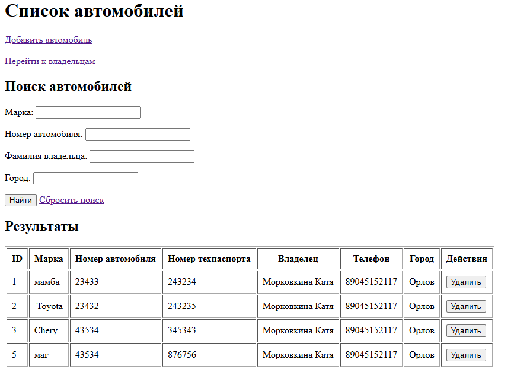
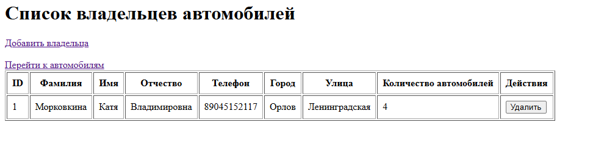

## Цель работы
Создание запросов к БД с использованием SQL-запросов

## Архитектура проекта
- **Стек:** Spring Boot 3, Maven/Gradle
- **СУБД:** H2
- **Основные слои:** 
  - Controller (endpoints)
  - Repository — выполнение SQL-запросов с помощью JdbcTemplate.
  - Entity — классы моделей Owner, Car, Address.
  - DTO — объекты для передачи и проверки данных.
- **Ключевые аннотации:**
    - @Controller
    - @Repository
    - @GetMapping
    - @PostMapping
    - @ModelAttribute
    - @Valid
    - @NotBlank
    - @Size
    - @Pattern. 
- **Описание моделей данных и DTO**
    - Owner — владелец автомобиля (ФИО, телефон, адрес).
    - Car — автомобиль (марка, государственный номер, номер техпаспорта).
    - Address — адрес владельца.
    - OwnerCreateDTO — данные для создания и изменения владельца.
    - CarCreateDTO — данные для создания и изменения автомобиля.
    - SearchDTO — параметры поиска автомобилей.
- **Описание реализованных мапперов**
    - OwnerMapper и CarMapper преобразуют результаты SQL-запросов (ResultSet) в Java-объекты.

## Алгоритм работы
 - При запуске приложения Spring Boot создаёт необходимые компоненты и подключается к базе данных.
 - Пользователь открывает страницы со списками владельцев и автомобилей.
 - Для получения данных репозитории выполняют SQL-запросы через JdbcTemplate.
 - При добавлении владельца сначала сохраняется его адрес, затем данные владельца с полученным идентификатором адреса.
 - При добавлении автомобиля сохраняются его характеристики и идентификатор выбранного владельца.
 - Реализованы поиск автомобилей по марке, номеру, фамилии владельца и городу, а также удаление автомобилей и владельцев.
 - Для преобразования результатов запросов в объекты используются специальные RowMapper-классы.

## Скриншоты результатов тестирования

   ### Добавление автомобиля
  
  
   ### Добавление владельца
   
  
   ### После добавления автомобиля
   
  
   ### После удаление автомобиля
  

   ### Список автомобилей
  
  
   ### Список Владельцев
  
  
